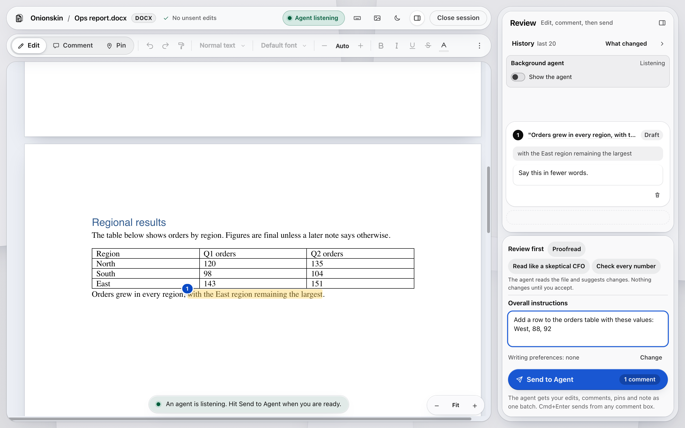

# Onionskin

Edit a Word, Excel, PowerPoint or HTML file in your browser, leave comments, and let your coding agent make the changes in the real file in realtime.




*The demo is a real run, recorded in the real app with its background agent: the file changed 7.8 seconds after Send. Nothing is sped up.*

## Install

Paste this sentence into Claude Code or Codex:

> Install Onionskin from https://github.com/abe238/onionskin

That is the whole install, and the way we recommend. Your agent does the rest and tells you when it is ready.

### Other ways to install

Pick one. The Terminal, npm and zip routes install the app and the skill.

To open Terminal: press Command-Space, type `Terminal`, then press Return.

**Terminal**

1. Paste these two lines into Terminal together, then press Return:

   ```sh
   RELEASE=https://github.com/abe238/onionskin/releases/latest/download
   curl -fsSL --proto "=https" --proto-redir "=https" "$RELEASE/get.sh" | ONIONSKIN_BASE_URL="$RELEASE" sh
   ```

**npm** (if you already use npm)

1. In Terminal, run:

   ```sh
   npm install -g onionskin-cli
   ```

2. In Terminal, run:

   ```sh
   onionskin setup
   ```

**Plugins.** A plugin is the right choice if you already manage your skills as Claude Code or Codex plugins; for everyone else, the sentence above is simpler. A plugin brings the skill only. The first time you ask for Onionskin, your agent installs the app with the Terminal command above.

**Claude Code plugin**

1. In Terminal, run:

   ```sh
   claude plugin marketplace add abe238/onionskin
   ```

2. In Terminal, run:

   ```sh
   claude plugin install onionskin@onionskin
   ```

3. Turn on auto-update. Inside Claude Code, type `/plugin`, open the Marketplaces tab, select onionskin, and choose "Enable auto-update". Claude Code then keeps the skill current by itself (a new version applies on the next launch, or after `/reload-plugins`). This covers the skill only. The app updates when you run `onionskin update` (see [Stay up to date](#stay-up-to-date)).

Already inside Claude Code? Steps 1 and 2 also work there as `/plugin marketplace add abe238/onionskin`, then `/plugin install onionskin@onionskin`.

**Codex plugin**

1. In Terminal, run:

   ```sh
   codex plugin marketplace add abe238/onionskin
   ```

2. In Terminal, run:

   ```sh
   codex plugin add onionskin@onionskin
   ```

**Zip**

1. Download `onionskin.zip` from the [latest release](https://github.com/abe238/onionskin/releases/latest) and double-click it to unzip it.
2. In Terminal, type `cd ` (with a space after it), drag the `onionskin` folder onto the Terminal window, then press Return.
3. In Terminal, run:

   ```sh
   sh install.sh
   ```

### Check it worked

```sh
onionskin doctor
```

Each line starts with `OK`, `NOTE` or `MISSING`. A `MISSING` line ends with the command that fixes it. If Terminal says the command is not found, run `~/.local/bin/onionskin doctor`.

### Stay up to date

The simplest way: tell your agent "update Onionskin". Or run this in Terminal:

```sh
onionskin update
```

`onionskin update` is new in 0.0.5. On 0.0.3 or older (`onionskin --version` shows yours), paste the install sentence into your agent again, or with npm run the two npm commands in the table below. Either brings the latest release.

`onionskin update` updates your copy the way it was installed, the app and the skill together, and keeps your snapshots. `onionskin update --check` only says whether a newer release exists. If Terminal says the command is not found, run `~/.local/bin/onionskin update`.

If a file is open in Onionskin in a browser tab (or its tab was open in the last 20 minutes), or has draft comments or a batch the agent has not finished, it stops and says so, because the update restarts Onionskin, the open tab cannot reconnect, and edits typed there and not sent would be lost. Send or finish first, then press Close session in the file's page (or close its tab and wait 20 minutes), or run `onionskin update --force`. `--check` never stops anything.

| How you installed | To update | Automatic? |
| --- | --- | --- |
| Pasted sentence, Terminal or zip | `onionskin update`. It downloads the latest release with the same checked download as the install. | No |
| npm | `onionskin update` prints two commands: `npm install -g onionskin-cli`, then `onionskin setup --force` (this replaces the older skill folders). `onionskin update --yes` runs them for you. | No |
| Claude Code plugin | Skill: turn on auto-update (step 3 above), or run `claude plugin marketplace update onionskin`, then `claude plugin update onionskin@onionskin`, then restart Claude Code. App: `onionskin update`. | Skill: yes, once you turn on auto-update. App: no |
| Codex plugin | Skill: `codex plugin marketplace upgrade onionskin`. App: `onionskin update`. | Manual |

Onionskin never checks for updates by itself, so nothing leaves your Mac unless you ask. Every release is listed at https://github.com/abe238/onionskin/releases. For a notice when a new one comes out, Watch the repository on GitHub for releases.

### Uninstall

- Terminal or zip install: `sh ~/.onionskin/app/*/install.sh --uninstall`. This keeps your snapshots in `~/.onionskin`. To delete those too, add `--purge`.
- npm: `onionskin setup --uninstall`, then `npm uninstall -g onionskin-cli`.
- Claude Code plugin: `claude plugin uninstall onionskin@onionskin`.
- Codex plugin: `codex plugin remove onionskin@onionskin`.

Removing a plugin removes the skill only. The `onionskin` command stays until you remove it with the Terminal line above.

### For the agent doing the install

You were asked to install Onionskin. Run this as one shell command from any folder. It needs no sudo and does not ask the person to type anything.

```sh
RELEASE=https://github.com/abe238/onionskin/releases/latest/download
curl -fsSL --proto "=https" --proto-redir "=https" "$RELEASE/get.sh" | ONIONSKIN_BASE_URL="$RELEASE" sh
onionskin doctor   # if "command not found", run ~/.local/bin/onionskin doctor
```

- The script checks the download's SHA-256 and installs under `~/.onionskin`, `~/.local/bin`, `~/.claude/skills/onionskin` and `~/.agents/skills/onionskin`. Its last lines say what was installed.
- If it says Node.js 22 or newer is missing or too old, tell the person plainly and give them https://nodejs.org/en/download (the macOS Installer). Ask them to run it and then ask you again. Do not install Node.js yourself.
- If `onionskin doctor` shows a line starting with `MISSING`, run the command at the end of that line, then run doctor again.
- Then tell the person exactly this and nothing else (no paths, versions or install details): "Onionskin is installed. To use it, say: open <your file> in Onionskin"

## Use it

Two ways to start:

- Say to your agent: **open report.docx in Onionskin**
- Or type this in a terminal: `onionskin report.docx`

The same works for a spreadsheet, a presentation or a web page: `onionskin page.html`.

Your file opens in the browser. Edit the text, comment on a spot, drop a pin, then press **Send to Agent**. The changes appear in the document, and **Revert** puts the last one back.

Who does the work depends on how you started:

- **From a terminal** (`onionskin report.docx`): Onionskin starts its own background agent. It is Claude Code only, it runs on your own Claude plan, and it needs Claude Code installed and signed in. A **Show the agent** switch shows what it is doing, and **Open in Terminal** opens the same conversation in Terminal. On a Mac with Codex but no Claude Code, the terminal says so in plain words and tells you to ask Codex instead.
- **From inside Claude Code or Codex** ("open report.docx in Onionskin"): the agent you are talking to does the work.

The background agent is limited on purpose. It can change your document only through Onionskin's own commands, it cannot read your other files, and it is started without any API keys.

## What it can do

- Opens a `.docx`, `.xlsx`, `.pptx`, `.html` or `.htm` file in a browser editor with a review panel beside it, and keeps the file's own formatting.
- Lets you edit the text yourself, comment on a selection, a cell, a range, a shape or a slide, drop numbered pins, and write one overall note.
- Sends all of that to your agent when you press Send. The page reloads in place and keeps your position.
- In Word, Excel and PowerPoint files, lets you keep editing while the agent works, and merges your edits with its version when it finishes.
- Shows what changed in red and green, keeps a history, and has a Revert button for the last agent run.
- Exports a Word file with real tracked changes.
- In Excel, Shift+Enter or Alt+Enter starts a new line inside a cell.
- Edits structure in your file: add or delete a table row or column in Word, and copy, delete or move a slide in PowerPoint. Charts are not edited: the agent tells you to insert the chart in Word or PowerPoint. Excel merged cells are understood.
- Runs plain commands such as "Replace Acme with Initech" and quick grammar fixes on your Mac.

## HTML files

Open a `.html` or `.htm` page the same way. Select text or click a part of the page to comment, fix text directly, and press Send. The agent edits the real file, and History and Revert work as for the other files.

Four things to know:

- The view is a still picture of the page. Scripts never run in it.
- Nothing loads from the internet. Images and styles in the page's folder are shown.
- You edit text. Structure changes, such as a new paragraph, go to the agent as comments.
- Onionskin never lets an agent add code that runs in a browser: scripts, event handlers, frames, forms or anything loaded from the internet. Such a change is refused whole: "The agent tried to add code that runs in a browser, so nothing was written."

Limits: 10 MB and 200,000 elements, UTF-8 only. Chrome is the tested browser. Details: [HTML files](docs/GUIDE.md#html-files).

## What you need

- A Mac, a browser, and Node.js 22 or newer (your agent will tell you if it is missing).
- Claude Code or Codex, already installed and signed in. The terminal start needs Claude Code; with Codex, you start from inside it.
- For quick fixes only: macOS 26 or later, Apple silicon and Apple Intelligence turned on. Without it, grammar fixes go to your agent.

Limits: macOS only so far. This is a pre-release (0.0.6) and has been tested by one person. No Windows, no Linux, no real-time collaboration. Files up to about 1,600 Word pages, 1,000,000 Excel cells, 50,000 PowerPoint shapes or 10 MB of HTML: the full list is in [Size limits](docs/GUIDE.md#size-limits).

## Privacy

The editor runs on your computer and the page makes no outside requests. Your document's text goes to the coding agent you already use (Claude Code or Codex) when you press Send. Every batch carries the text of the whole document, not only the part you commented on, because the agent needs it to find the right place. Only quick fixes and the no-AI quick commands stay entirely on the Mac.

## Credits

- The document engine is a fork of [office-engine](https://github.com/p10node/office-engine) by p10node (MIT).
- The review loop and the agent skill's wording descend from [human-review](https://github.com/petergyang/human-review) by Peter Yang (MIT).

## License

MIT. See [LICENSE](LICENSE) and [NOTICE](NOTICE).

## Made by abe238

[GitHub: abe238](https://github.com/abe238) · [abediaz.com](https://abediaz.com) · [X: @abe238](https://x.com/abe238)

If Onionskin saves you time, a star on the repo helps other people find it.

For developers: [docs/DEVELOPERS.md](docs/DEVELOPERS.md)
