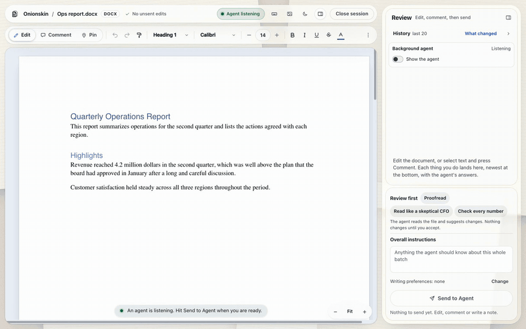

# Onionskin

Edit a Word, Excel or PowerPoint file in your browser, leave comments, and let your coding agent make the changes in the real file.




*The demo is a real run, recorded in the real app with its background agent: the file changed 7.8 seconds after Send. Nothing is sped up.*

## Install

Paste this sentence into Claude Code or Codex:

> Install Onionskin from https://github.com/abe238/onionskin

That is the whole install. Your agent does the rest and tells you when it is ready.

### For the agent doing the install

You were asked to install Onionskin. Run this as one shell command from any folder. It needs no sudo and does not ask the person to type anything.

```sh
RELEASE=https://github.com/abe238/onionskin/releases/latest/download
curl -fsSL "$RELEASE/get.sh" | ONIONSKIN_BASE_URL="$RELEASE" sh
onionskin doctor   # if "command not found", run ~/.local/bin/onionskin doctor
```

- The script checks the download's SHA-256 and installs under `~/.onionskin`, `~/.local/bin`, `~/.claude/skills/onionskin` and `~/.agents/skills/onionskin`. Its last lines say what was installed.
- If it says Node.js 22 or newer is missing or too old, tell the person plainly and give them https://nodejs.org/en/download (the macOS Installer). Ask them to run it and then ask you again. Do not install Node.js yourself.
- If `onionskin doctor` shows a line starting with `MISSING`, run the command at the end of that line, then run doctor again.
- Then tell the person exactly this and nothing else (no paths, versions or install details): "Onionskin is installed. To use it, say: open <your file> in Onionskin"

## Use it

Two ways to start:

- Say to your agent: **open report.docx in Onionskin**
- Or type this in a terminal: `onionskin report.docx`

Your file opens in the browser. Edit the text, comment on a spot, drop a pin, then press **Send to Agent**. The changes appear in the document, and **Revert** puts the last one back.

Who does the work depends on how you started:

- **From a terminal** (`onionskin report.docx`): Onionskin starts its own background agent. It is Claude Code only, it runs on your own Claude plan, and it needs Claude Code installed and signed in. A **Show the agent** switch shows what it is doing, and **Open in Terminal** opens the same conversation in Terminal. On a Mac with Codex but no Claude Code, the terminal says so in plain words and tells you to ask Codex instead.
- **From inside Claude Code or Codex** ("open report.docx in Onionskin"): the agent you are talking to does the work.

The background agent is limited on purpose. It can change your document only through Onionskin's own commands, it cannot read your other files, and it is started without any API keys.

## What it can do

- Opens a `.docx`, `.xlsx` or `.pptx` in a browser editor with a review panel beside it, and keeps the file's own formatting.
- Lets you edit the text yourself, comment on a selection, a cell, a range, a shape or a slide, drop numbered pins, and write one overall note.
- Sends all of that to your agent when you press Send. The page reloads in place and keeps your position.
- Lets you keep editing while the agent works, and merges your edits with its version when it finishes.
- Shows what changed in red and green, keeps a history, and has a Revert button for the last agent run.
- Exports a Word file with real tracked changes.
- In Excel, Shift+Enter or Alt+Enter starts a new line inside a cell.
- Edits structure in your file: add or delete a table row or column in Word, and copy, delete or move a slide in PowerPoint. Charts are not edited: the agent tells you to insert the chart in Word or PowerPoint. Excel merged cells are understood.
- Runs plain commands such as "Replace Acme with Initech" and quick grammar fixes on your Mac.

## What you need

- A Mac, a browser, and Node.js 22 or newer (your agent will tell you if it is missing).
- Claude Code or Codex, already installed and signed in. The terminal start needs Claude Code; with Codex, you start from inside it.
- For quick fixes only: macOS 26 or later, Apple silicon and Apple Intelligence turned on. Without it, grammar fixes go to your agent.

Limits: macOS only so far. This is a pre-release (0.0.1) and has been tested by one person. No Windows, no Linux, no real-time collaboration.

## Privacy

The editor runs on your computer and the page makes no outside requests. Your document's text goes to the coding agent you already use (Claude Code or Codex) when you press Send. Every batch carries the text of the whole document, not only the part you commented on, because the agent needs it to find the right place. Only quick fixes and the no-AI quick commands stay entirely on the Mac.

## Credits

- The document engine is a fork of [office-engine](https://github.com/p10node/office-engine) by p10node (MIT).
- The review loop and the agent skill's wording descend from [human-review](https://github.com/petergyang/human-review) by Peter Yang (MIT).

## License

MIT. See [LICENSE](LICENSE) and [NOTICE](NOTICE).

## Made by abe238

[GitHub: abe238](https://github.com/abe238) · [abediaz.com](https://abediaz.com) · [X: @abe238](https://x.com/abe238)

If Onionskin saves you time, a star on the repo helps other people find it.

For developers: [docs/DEVELOPERS.md](docs/DEVELOPERS.md)
